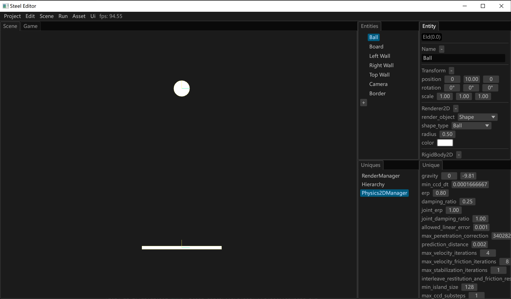
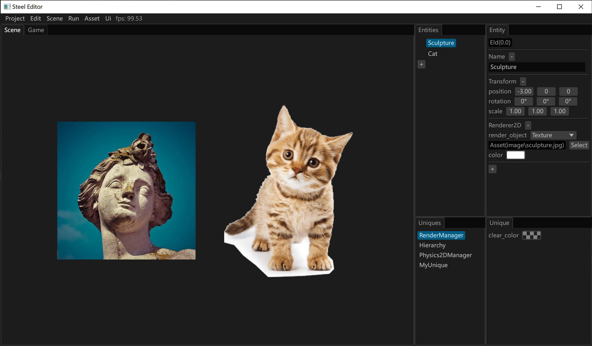
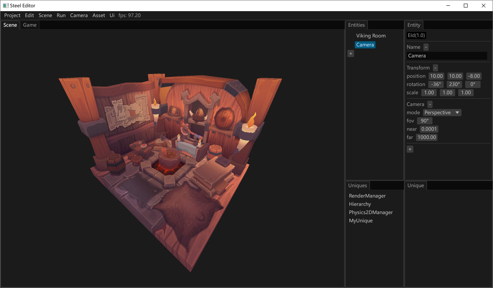
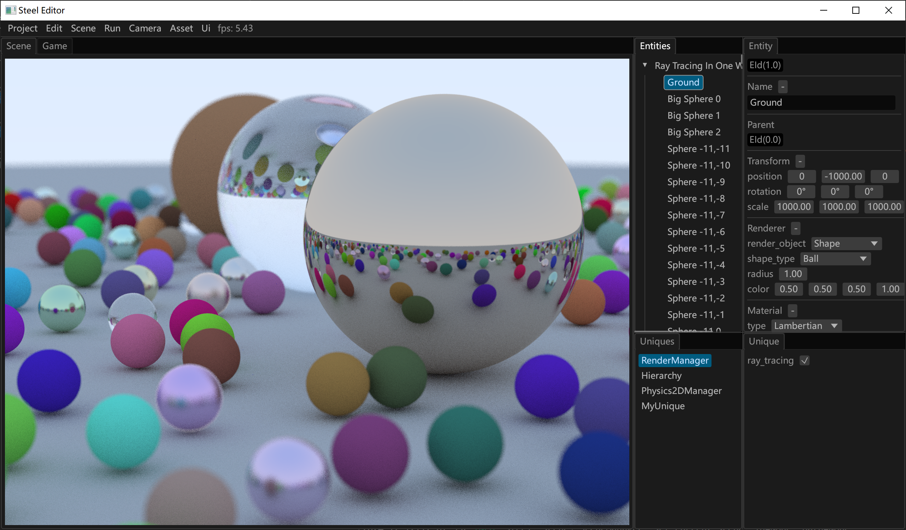

# The Steel Game Engine

Steel is an open-source Rust game engine with an integrated editor. It supports rasterization and real-time ray tracing (path tracing). The editor and game client are launched by a Steel application; the editor is not a standalone executable.

# Design Goals

* **Open source**: The Steel game engine is completely open source, and the engine layer code can be easily modified if necessary.
* **Simple**: Game engines are very complex. In order to write a game engine in the simplest way, Steel only implements the necessary core game modules. In addition, Steel uses the widely used open source libraries, such as [shipyard][shipyard], [glam][glam], [egui][egui], [vulkano][vulkano], [rapier][rapier], etc. So Steel can focus on implementing editor functions and rendering effects.
* **Modularity**: General game modules, such as physics engines, can be added as plugins. You can easily add any plugin written by others, or you can write a plugin for others to use.
* **Fast**: Steel is fast on both the CPU and GPU sides. Steel uses Rust and ECS architecture, which can easily write high-performance and high-concurrency code, thereby achieving high performance on the CPU side. Steel uses Vulkan, an advanced graphics API, to achieve high performance on the GPU side.
* **Cross-platform**: Steel's game client supports Windows and Android. The integrated editor currently runs on desktop; Android builds use the client and do not support the editor.
* **Easy to use**: The integrated editor and engine are developed together and can be enabled by building an application with the `editor` feature.

# Build and run

## Environment Setup

1. Install [Visual Studio 2022][Visual Studio 2022] with "Desktop development with C++" in Windows, keep the default check.
2. Install [Rust][Rust], [Git][Git], [Python][Python], [CMake][CMake] and [Ninja][Ninja] for [shaderc-rs][shaderc-rs].
3. Install [VSCode][VSCode] with "C/C++" and "rust-analyzer" extensions.

The editor is part of a Steel application, not a separate `steel-editor` executable. The examples below are workspace members and can be run from their directories.

## Run from Source

1. Clone the repository:
```
git clone https://github.com/SSSxCCC/steel
cd steel
```
2. Run the ball example with the editor enabled:
```
cd examples/ball
cargo run --features steel-engine/editor
```

To run the same example as a game client without the editor, omit the feature:
```
cargo run
```

To run the single-file hello-world example with the editor from the repository root:
```
cargo run --example hello_world --features editor
```

Changing game code requires rebuilding and relaunching the application. The editor's Project menu does not compile Rust source code.

## Android client

Android builds use `steel-client`; do not enable the editor feature. Install the Android SDK/NDK and Java, then install the Rust target and cargo-ndk:
```
rustup target add aarch64-linux-android
cargo install cargo-ndk
```

For the ball example, build the Android native library into the included Gradle application's `jniLibs` directory:
```
cargo ndk -t arm64-v8a -o ../android-project/app/src/main/jniLibs build --lib
```

Copy the contents of `examples/ball/assets` to `examples/android-project/app/src/main/assets`, then run `gradlew assembleDebug` (`gradlew.bat assembleDebug` on Windows) from `examples/android-project`. The wrapper currently targets arm64 Android devices and requires the SDK/NDK versions configured in its Gradle files.

## Vendored graphics dependencies

Vulkano, Vulkano-util, and egui_winit_vulkano are included under `dependencies/` so Steel can carry the local changes needed to address [vulkano-rs/vulkano#2711](https://github.com/vulkano-rs/vulkano/issues/2711) while an upstream release containing the fix is unavailable.

# Tutorial

You can learn about the Steel engine through this [tutorial](tutorial/eng/1-introduction.md).

# Examples

There are several examples under `examples/`. `examples/hello_world.rs` is a single-file example:
```
cargo run --example hello_world --features editor
```

`examples/empty-project` is a starter application. Run `cargo run` for the client, or `cargo run --features steel-engine/editor` to run it with the desktop editor.

# Editor demo









# Development Roadmap

- [x] Game core module
- [x] Visual editor
- [x] Vulkan render pipeline
- [x] 2D rendering basic
- [x] 2D texture
- [x] 3D rendering basic
- [x] obj model
- [ ] gltf model
- [x] Ray traced rendering
- [x] 2D physics
- [ ] 3D physics
- [x] Asset manager
- [ ] Audio
- [ ] Animation
- [ ] Particle system
- [ ] Network synchronization
- [ ] AI
- [x] Run on Windows
- [x] Run on Android
- [x] Write a tutorial
- [ ] Tests

# Contributing

Steel is still in the early stages of development, and the core API is subject to change. Any contributions are welcome.

If you find any problems, feel free to open an issue.

If you find a fix for a minor bug, or any code that can be optimized, you can directly file a pull request.

If you have a major code change idea, please open an issue first to discuss it with us.

[shipyard]: https://github.com/leudz/shipyard
[glam]: https://github.com/bitshifter/glam-rs
[egui]: https://github.com/emilk/egui
[vulkano]: https://github.com/vulkano-rs/vulkano
[rapier]: https://rapier.rs/
[Rust]: https://www.rust-lang.org/
[Git]: https://git-scm.com/
[Python]: https://www.python.org/
[CMake]: https://cmake.org/
[Ninja]: https://github.com/ninja-build/ninja/releases
[shaderc-rs]: https://github.com/google/shaderc-rs
[Visual Studio 2022]: https://visualstudio.microsoft.com/vs/
[VSCode]: https://code.visualstudio.com/
