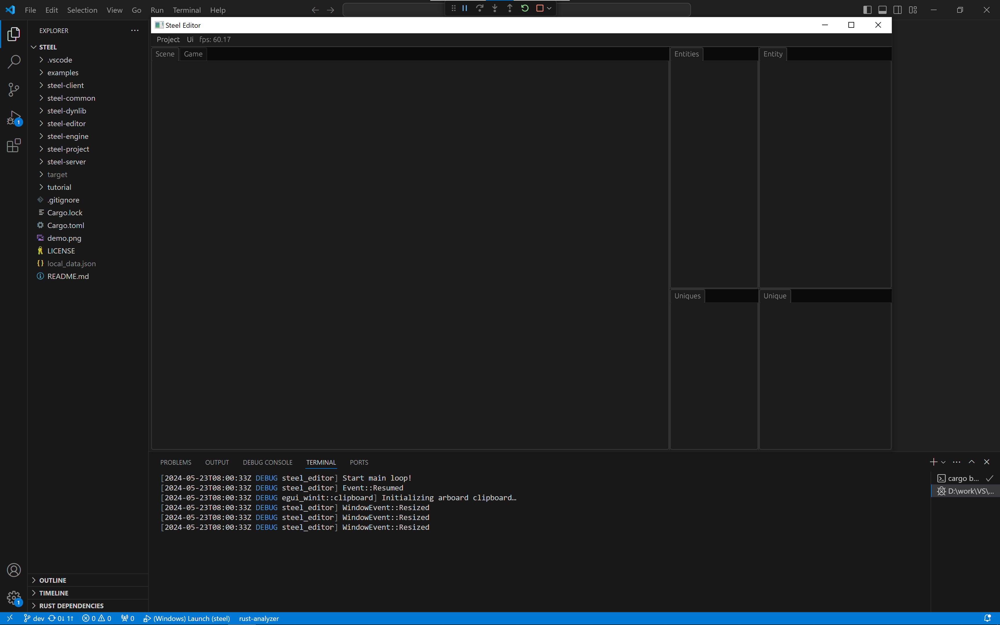

# 运行Steel编辑器

## 环境准备

在Windows上安装[Rust][Rust]、[Git][Git]和[Visual Studio 2022][Visual Studio 2022]（勾选“使用C++的桌面开发”）。构建着色器依赖还需要[Python][Python]、[CMake][CMake]和[Ninja][Ninja]。推荐使用带有“C/C++”和“rust-analyzer”扩展的[VSCode][VSCode]。

Steel编辑器集成在Steel应用中，不再是独立可执行程序。桌面应用启用`editor` feature后会启动编辑器；Android应用应使用`steel-client`，不支持编辑器。

## 从源码运行

1. 克隆仓库：
```
git clone https://github.com/SSSxCCC/steel
cd steel
```
2. 从接球示例目录启动编辑器：
```
cd examples/ball
cargo run --features steel-engine/editor
```

也可以从仓库根目录运行单文件hello-world示例：
```
cargo run --example hello_world --features editor
```

编辑器使用进程当前工作目录下的`assets`目录。接球示例命令需要从`examples/ball`目录运行，这样才能使用该示例的场景和资源。修改游戏Rust代码后，需要重新构建并启动应用；“Project -> Compile”不会编译Rust源码。

不启用编辑器时，在示例目录直接执行`cargo run`即可通过`steel-client`运行游戏。

## Steel编辑器界面介绍

成功运行Steel编辑器后，你可以看到如下界面：



整个界面的前面是编辑器窗口，在编辑器窗口中有顶部菜单功能按钮，和多个子页面。子页面主要包括：
* Scene：场景窗口，这个窗口用于查看场景内容；
* Game：游戏窗口，这个窗口用于查看实际游戏画面；
* Entities：显示当前场景所有的实体（Entity）；
* Entity：显示当前选中的实体的所有组件（Component）；
* Uniques：显示当前场景所有的单例（Unique）；
* Unique：显示当前选中的单例的内容。

请从终端运行命令以查看log输出。你可以使用VSCode查看和修改Steel引擎及示例应用源码。

`examples/ball`目录包含本教程接球游戏的源码和资源，遇到困难时可以参考该示例。

[下一章：创建项目][3]

[上一章：引言][1]

[目录][0]

[0]: 目录.md
[1]: 1-引言.md
[2]: 2-运行Steel编辑器.md
[3]: 3-创建项目.md
[4]: 4-编写代码.md
[5]: 5-场景搭建.md
[6]: 6-玩家控制.md
[7]: 7-推一下球.md
[8]: 8-游戏失败.md
[9]: 9-主菜单.md
[Rust]: https://www.rust-lang.org/
[Git]: https://git-scm.com/
[Python]: https://www.python.org/
[CMake]: https://cmake.org/
[Ninja]: https://github.com/ninja-build/ninja/releases
[shaderc-rs]: https://github.com/google/shaderc-rs
[Visual Studio 2022]: https://visualstudio.microsoft.com/vs/
[VSCode]: https://code.visualstudio.com/
